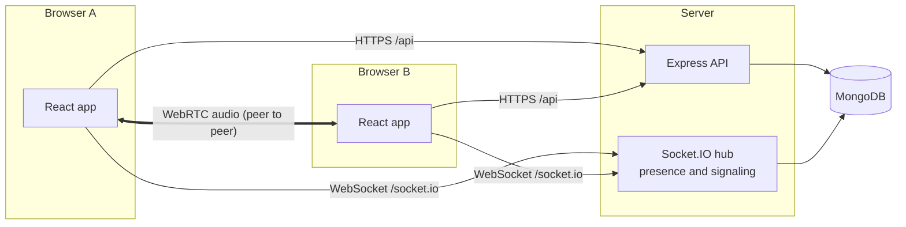

# Architecture

DevsBooth is three things: a small HTTP API, a Socket.IO hub that introduces people and tracks who is in which room, and a web client that carries the audio itself, browser to browser, over WebRTC.

The server never touches audio. It stores accounts, follows and rooms, decides who may enter a room and with what role, and relays the WebRTC offers, answers and ICE candidates that let browsers connect to each other.

## Repository

| Package  | What it holds                                                                                                                                                                      |
| -------- | ---------------------------------------------------------------------------------------------------------------------------------------------------------------------------------- |
| `shared` | TypeScript types and limits used by both sides: API shapes, the Socket.IO event maps, input rules. No runtime dependencies; bundled into the server and the client at build time.  |
| `server` | `createApp(config)` builds Express, the HTTP server and Socket.IO. `index.ts` loads configuration, connects to MongoDB and listens. In production it also serves the built client. |
| `web`    | Vite and React. `src/rtc` holds everything about being in a room.                                                                                                                  |
| `e2e`    | Playwright tests against the production build.                                                                                                                                     |

## Sign-in and sessions

1. `POST /api/auth/code { email }` creates a login code record and emails the code. The response carries a random `challenge`.
2. `POST /api/auth/verify { email, code, challenge }` reserves one attempt atomically, compares the code in constant time, creates the user if the address is new, and sets the session cookie.
3. Every later request and the Socket.IO handshake read that cookie.

Codes are 8 digits, stored as salted HMACs, valid for ten minutes and three guesses, and only redeemable with the challenge returned to the browser that asked for them. Quotas per requester and per address bound how many codes can be sent; [SECURITY.md](../SECURITY.md) has the numbers and the trade-offs.

Sessions are opaque: 32 random bytes in an `HttpOnly`, `SameSite=Lax` cookie, stored in MongoDB as a SHA-256 hash with a 30-day sliding expiry. There are no JWTs, so logging out ends a session immediately. State-changing requests must not come from another origin and must not use content types an HTML form can send, which closes cross-site request forgery on top of `SameSite`.

A user is onboarded once they have a name and a username. Until then the API only allows editing the profile, and the Socket.IO handshake refuses them.

## Rooms

A room has a random 10-character id (about 59 bits), which doubles as the private link, a topic, a type, an owner and a list of speakers.

| Type    | Listed for                           | Who can enter           |
| ------- | ------------------------------------ | ----------------------- |
| open    | everyone signed in                   | everyone signed in      |
| social  | the owner and people who follow them | the owner and followers |
| private | the owner                            | anyone with the link    |

The owner is always a speaker. When the host invites someone to speak, the server adds them to the room's `speakers`, so they keep the role if they reconnect.

Rooms end when the host ends them, or after staying empty for `ROOM_EMPTY_TTL` seconds. The timer starts when a room is created and whenever the last person leaves, and stops when someone joins. After a restart nobody is connected, so every live room starts its timer.

## Presence and signaling

Presence lives in memory in the server process (`server/src/realtime/presence.ts`): which socket is in which room, with which role, mute state and raised hand. A socket is one browser tab; its id is the peer id.

The events are typed in `shared/src/realtime.ts`.

| Client to server | Purpose                                                                                                 |
| ---------------- | ------------------------------------------------------------------------------------------------------- |
| `room:join`      | Enter a room. The acknowledgement carries the room, your participant record and everyone already there. |
| `room:leave`     | Leave. Disconnecting does the same.                                                                     |
| `rtc:signal`     | Relay an offer, answer or ICE candidate to another peer in the same room.                               |
| `mic:set`        | Mute or unmute. Listeners stay muted whatever they send.                                                |
| `hand:set`       | Raise or lower a hand. Listeners only.                                                                  |
| `role:set`       | Make a peer a speaker or a listener. The host only.                                                     |

| Server to client           | Purpose                                                                                 |
| -------------------------- | --------------------------------------------------------------------------------------- |
| `peer:joined`, `peer:left` | Someone arrived or left.                                                                |
| `peer:updated`             | Someone's role, mute or hand changed. Sent to everyone, including the person concerned. |
| `rtc:signal`               | A relayed offer, answer or candidate, with the sender's peer id.                        |
| `room:ended`               | The host ended the room, or it expired.                                                 |
| `room:kicked`              | The same person joined from another tab, which takes over.                              |

Every payload is validated with zod, and signals are only relayed between two peers in the same room.

## Audio

Each browser holds one `RTCPeerConnection` per other participant: a full mesh.

- **Who offers.** The newcomer creates an offer to everyone listed in its join acknowledgement. People already in the room only answer. Two sides never offer to each other at once, so there is no glare to resolve.
- **One transceiver from the start.** Every connection carries a single `sendrecv` audio transceiver. A listener's sender has no track. Promotion to speaker calls `replaceTrack` with the microphone, and so does switching microphones; neither needs renegotiation.
- **Mute** disables the local track and tells the server, which tells everyone.
- **Role enforcement on the receiving side.** A modified client could attach a microphone while listed as a listener. Every receiver therefore plays a peer's audio element only while the server's state says that peer is an unmuted speaker.
- **Levels.** Remote levels come from `RTCRtpReceiver.getSynchronizationSources()`, local levels from an `AnalyserNode`, about ten times a second. A level store outside React state feeds the meters, so a level change re-renders only its meter. Participant tiles expose `data-speaking`, which the end-to-end tests use to prove audio crossed between browsers.
- **Signaling order.** Work for each peer runs through a promise queue, and ICE candidates that arrive before the remote description wait for it.

### Limits of a full mesh

Every pair of participants holds a connection, and every speaker uploads one copy of their audio per listener. That is fine for the conversations DevsBooth is for, and is why rooms are capped at `ROOM_MAX_PARTICIPANTS` (default 25). Larger rooms would need a selective forwarding unit (SFU) such as mediasoup or LiveKit, which is a good future project.

Presence is per process, so one server process serves everyone. Running several would need a shared Socket.IO adapter and shared presence.

## Web client

- **Routing.** React Router with guards: signed-out visitors are sent to `/signin?next=...`, signed-in people without a username to `/welcome`. `next` is resolved against the current origin, so it cannot point elsewhere.
- **Server state.** TanStack Query. The rooms list refetches every ten seconds for live counts.
- **The room.** `useRoomSession` owns the socket, the mesh, the microphone and the level polling, and keeps participants in a reducer (`room-state.ts`) that is unit tested on its own.
- **Styling.** CSS modules over a small set of design tokens in `styles/global.css`, light and dark. One variable font, Archivo, self-hosted.

## Security headers

The server sends a strict Content Security Policy (scripts, styles, fonts and connections from its own origin only), `X-Frame-Options`, `Referrer-Policy: no-referrer`, and HSTS when `APP_URL` is https.
